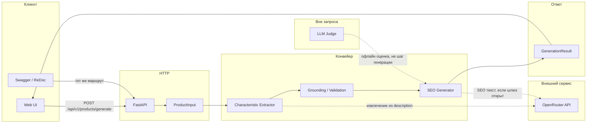
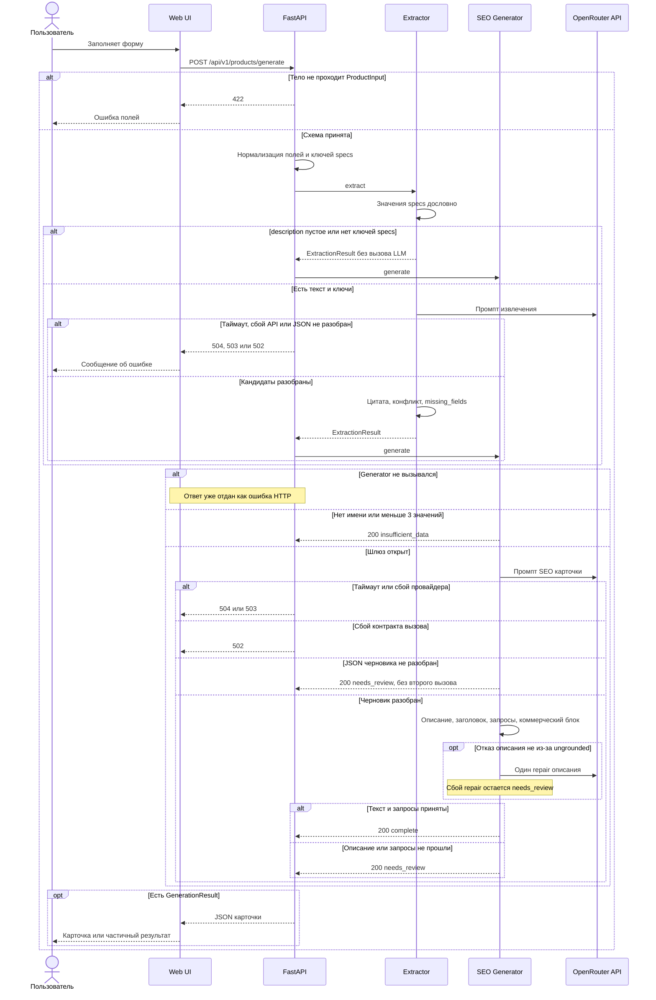
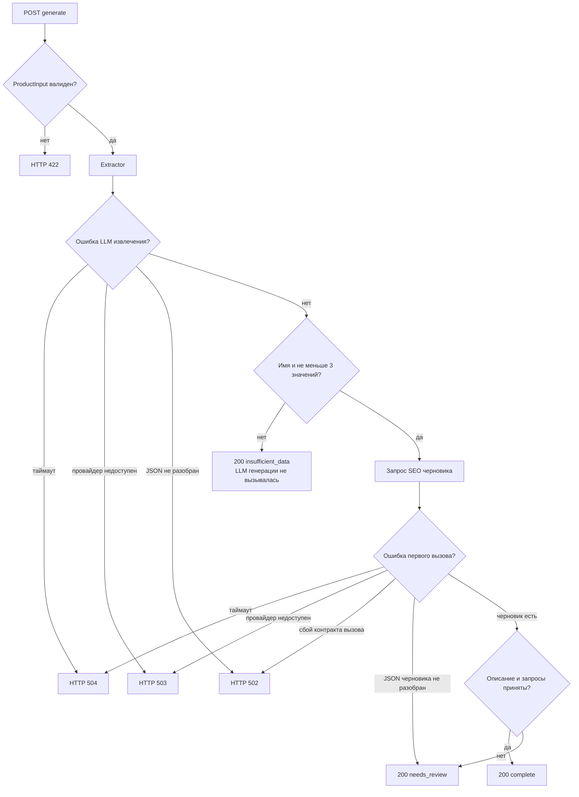
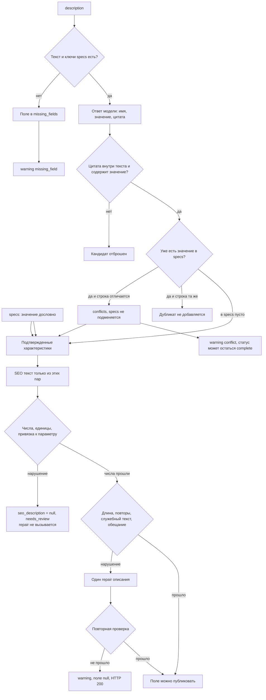

# AI Product Card Generator

Тестовое задание на позицию **Python / AI Developer**.

AI-сервис на FastAPI для генерации SEO-карточек товаров B2B-интернет-магазина измерительных приборов. Сервис принимает JSON с названием, производителем, характеристиками и техническим описанием, извлекает подтвержденные параметры и формирует SEO-контент **без выдуманных технических характеристик**.

## Возможности сервиса

- Веб-страница контент-менеджера (`GET /`) со статикой CSS/JS.
- REST API генерации карточки: `POST /api/v1/products/generate`.
- Извлечение характеристик из `specs` и (при наличии) из `description` через LLM с проверкой цитат.
- Формирование SEO-заголовка, описания, поисковых запросов и коммерческого блока.
- Частичный ответ при нехватке данных (`status: insufficient_data`, HTTP 200).
- Статус `needs_review` (HTTP 200), если текст модели не прошел проверку: публикуемые поля могут быть `null`.
- OpenAPI: Swagger UI и ReDoc.
- Health-check: `GET /health`.
- Запуск через `uv`, Docker и Docker Compose.

## Стек

| Компонент | Технология |
|-----------|------------|
| Язык | Python 3.12+ |
| API | FastAPI, Uvicorn |
| Валидация / настройки | Pydantic v2, pydantic-settings |
| LLM | OpenAI-совместимый клиент (`openai` + `httpx`), по умолчанию через OpenRouter |
| Зависимости | `uv` + `uv.lock` |
| Тесты / линт | pytest, pytest-asyncio, Ruff |
| Контейнеризация | Docker, Docker Compose |

## Архитектура

Запрос идет по цепочке **Web UI -> FastAPI -> Characteristic Extractor -> SEO Generator -> GenerationResult**. OpenRouter вызывается из Extractor, если есть текст описания, и из Generator, только когда шлюз полноты открыт. LLM Judge в этот путь не входит: это офлайн оценка в `app/evals/`.

Слои и обработка ошибок также описаны в [`docs/architecture.md`](docs/architecture.md).



Подтвержденные характеристики собирает Extractor. Generator не перечитывает исходное описание и не подменяет `specifications` текстом модели.

## Как работает генерация

1. Клиент отправляет `ProductInput` на `POST /api/v1/products/generate`.
2. FastAPI валидирует тело (при ошибке — **422**).
3. Нормализуются `name`, `manufacturer`, `description`, ключи `specs`.
4. **Extractor** берет значения из `specs` дословно; при непустом `description` вызывает LLM и принимает только пары с подтверждающей цитатой (`validators.supported_quote`).
5. Конфликты specs↔description фиксируются; значение из specs не подменяется.
6. **SEO Generator** оценивает достаточность данных (имя + не меньше трех подтвержденных значений):
   - данных мало -> **200** с `insufficient_data`, без вызова LLM;
   - данных достаточно -> запрос к LLM на SEO текст, проверка фактов и сборка `GenerationResult`.
7. Сбои провайдера на обязательном вызове мапятся на **502 / 503 / 504**. Непрошедший текст и неразобранный JSON генерации дают **200** `needs_review`. Неразборчивый JSON извлечения по-прежнему **502**.

Жизненный цикл одного запроса. Второй вызов модели бывает только как точечный repair описания и только если первая проверка не упала на неподтвержденном числе или единице (`ungrounded`). Ошибка repair не превращается в ошибку HTTP: остается исходный отказ описания.



## Как строится SEO-карточка

1. Основной запрос к модели возвращает заголовок, описание, 3–5 запросов и коммерческий блок.
2. Ответ проходит проверку фактов: числа, единицы, привязка значений к параметрам, выдуманные характеристики, гарантии, сертификаты, отрасли, служебный текст, повторы.
3. Описание длиннее 1200 знаков обрезается по границе предложения без обращения к модели.
4. Описание короче 800 знаков, с повторами или служебными фразами исправляется одним дополнительным запросом, который переписывает только описание. Ошибка проверки чисел и единиц повторный запрос не вызывает.
5. Если и после этого текст не годится, сервис возвращает `needs_review` с `seo_description: null` и причиной в `warnings`. Ответ **200**, не **502**.

Больше двух обращений к модели на карточку не бывает. LLM Judge в обычной генерации не вызывается.

Публикуемые поля: `seo_title`, `seo_description`, `specifications`, `search_queries`, `commercial_block`. Диагностика отдельно: `status`, `warnings`, `missing_fields`. Если готового текста нет, поле равно `null`, а не сообщению об ошибке.

| Статус | Что значит |
|--------|------------|
| `complete` | Заголовок до 70 знаков, описание 800–1200, 3–5 запросов, коммерческий блок |
| `needs_review` | Часть полей не прошла проверку, подтвержденные характеристики сохранены |
| `insufficient_data` | Подтвержденных данных мало, модель не вызывалась |

## Статусы и обработка ошибок

Три значения `GenerationStatus` возвращаются с HTTP **200**. Коды **422 / 502 / 503 / 504** — это отказ запроса, а не статус карточки. Нехватка входа, отказ текста и сбой провайдера не смешиваются.



`insufficient_data` ставится до вызова модели генерации. `needs_review` ставится, когда данных хватает, но описание не опубликовано или поисковых запросов меньше трех; характеристики при этом сохраняются. Заголовок и коммерческий блок при локальном отказе заменяются строкой из подтвержденных данных и сами по себе статус не переводят. Сбой repair описания остается внутри `needs_review` и не становится 502.

## Установка через uv

Требуется [uv](https://docs.astral.sh/uv/) и Python 3.12+.

```bash
uv sync --locked --extra dev
cp .env.example .env
```

`uv sync --locked` ставит зависимости строго по `uv.lock`. Флаг `--extra dev` нужен для pytest и Ruff.

Альтернатива через pip:

```bash
python -m venv .venv
# Windows: .venv\Scripts\activate
# Linux/macOS: source .venv/bin/activate
pip install -e ".[dev]"
cp .env.example .env
```

## Настройка .env

Скопируйте `.env.example` -> `.env` и задайте значения. Файл `.env` **не** попадает в Docker-образ.

| Переменная | Назначение | Рекомендация |
|------------|------------|--------------|
| `OPENAI_API_KEY` | Ключ провайдера (обязателен для вызовов LLM) | из кабинета провайдера |
| `OPENAI_MODEL`, `OPENAI_BASE_URL` | Модель и endpoint (OpenRouter) | `openai/gpt-4.1-mini` и `https://openrouter.ai/api/v1` |
| `OPENAI_TIMEOUT_SECONDS` | Таймаут одного запроса | `90` по умолчанию |
| `OPENAI_MAX_COMPLETION_TOKENS` | Лимит токенов ответа | `3000`–`4096`; слишком малый лимит обрезает JSON |
| `OPENAI_REASONING_EFFORT` | Усилие рассуждения reasoning-модели | `low` для скорости |
| `OPENAI_TEMPERATURE` | Температура | пусто, если модель ее не принимает |

На OpenRouter усилие рассуждения уходит как `reasoning.effort`, на остальных endpoint — как `reasoning_effort`.

Дополнительно для evaluation (опционально, см. `app/core/config.py`): `EVAL_GENERATOR_MODELS`, `EVAL_JUDGE_MODEL`.

Не коммитьте реальные ключи. В `docker-compose.yml` ключи не зашиты — только `env_file: .env`.

## Локальный запуск

```bash
uv run uvicorn app.main:app --reload --host 127.0.0.1 --port 8000
```

Проверка:

```bash
curl http://127.0.0.1:8000/health
```

Ожидается: `{"status":"ok"}`.

Интерфейс: <http://127.0.0.1:8000/>

## Запуск через Docker

Сборка:

```bash
docker build -t ai-product-card-generator:local .
```

Запуск (ключ передается с хоста, не вшивается в образ):

```bash
docker run --rm -p 8000:8000 --env-file .env ai-product-card-generator:local
```

Образ:

- Python 3.12, зависимости из `uv.lock` через `uv`, **без** dev-зависимостей;
- non-root пользователь `app` (uid 1000);
- HTML/CSS/JS входят в пакет `app` (`static/`, `web/`);
- Uvicorn в exec-форме с `--timeout-graceful-shutdown` для корректного SIGTERM;
- `.env`, `.git`, тесты, отчеты и локальные venv в образ не копируются.

## Запуск через Docker Compose

```bash
# в корне репозитория должен быть заполненный .env
docker compose config    # проверка файла
docker compose up --build
```

Сервис слушает порт **8000**, политика `restart: unless-stopped`, healthcheck бьет в `/health` через stdlib Python (без curl в образе).

Остановка:

```bash
docker compose down
```

## REST API

| Метод | Путь | Описание |
|-------|------|----------|
| `GET` | `/` | Веб-UI генерации карточки |
| `GET` | `/health` | Проверка работоспособности -> `{"status":"ok"}` |
| `GET` | `/docs` | Swagger UI |
| `GET` | `/redoc` | ReDoc |
| `POST` | `/api/v1/products/generate` | Генерация SEO-карточки |

Статика UI: `/static/...`.

### Коды ответа `POST /api/v1/products/generate`

| Код | Когда |
|-----|--------|
| **200** | Карточка собрана; в том числе `insufficient_data` / `needs_review` |
| **422** | Тело не соответствует `ProductInput` |
| **502** | Ответ LLM не принят по контракту модели |
| **503** | Провайдер LLM недоступен |
| **504** | Таймаут ответа провайдера |

Тела ошибок 502/503/504: `{"detail": "<сообщение без внутренних деталей>"}` (`ApiError`).

## Swagger UI и ReDoc

- Swagger UI: <http://127.0.0.1:8000/docs>
- ReDoc: <http://127.0.0.1:8000/redoc>

В Swagger есть демонстрационные примеры запроса и синтетические примеры ответа.

## Пример JSON-запроса

Демонстрационные файлы в [`examples/`](examples/):

| Файл | Назначение |
|------|------------|
| `manometer.json` / `manometer.request.json` | Манометр, сценарий полной карточки |
| `temperature_sensor.json` | Другой измерительный прибор |
| `thermometer_insufficient.json` / `thermometer.request.json` | Мало данных -> `insufficient_data` |

Манометр (учебный пример, не паспорт прибора):

```json
{
  "name": "Манометр демонстрационный МП-Демо-01",
  "manufacturer": "Учебный стенд «Сигнал»",
  "description": "Учебный пример, не паспорт реального прибора. Диапазон показаний 0...1,6 МПа. Класс точности 1,5. Присоединение M20x1,5. Степень защиты IP54.",
  "specs": {
    "Диапазон показаний": "0...1,6 МПа",
    "Класс точности": "1,5",
    "Присоединение": "M20x1,5",
    "Степень защиты": "IP54"
  }
}
```

```bash
curl -sS -X POST "http://127.0.0.1:8000/api/v1/products/generate" \
  -H "Content-Type: application/json" \
  --data-binary @examples/manometer.json
```

## Структура JSON-ответа

Ответ соответствует схеме `GenerationResult`:

| Поле | Тип | Смысл |
|------|-----|--------|
| `status` | `complete` \| `insufficient_data` \| `needs_review` | Итог сборки карточки |
| `seo_title` | string | SEO-заголовок (≤ 70 символов) |
| `seo_description` | string \| null | SEO-текст; для `complete` длина 800–1200; `null`, если готового описания нет |
| `specifications` | array | Подтвержденные характеристики (`name`, `value`, `source`, `evidence`) |
| `search_queries` | array | Поисковые запросы (для полной карточки обычно 3–5) |
| `commercial_block` | string \| null | Коммерческий блок; `null`, если блока нет |
| `missing_fields` | array | Неподтвержденные имена характеристик |
| `warnings` | array | `{code, field, message}` — диагностика, не для публикации |

Синтетические примеры формы ответа — в Swagger. **Готовых проверенных ответов реальной LLM в репозитории нет** — получите актуальный ответ через Swagger/`curl` после настройки ключа.

## Ручной E2E через OpenRouter

Автотесты по умолчанию не обращаются к сети. Реальные запросы платные.

**Swagger.** Запустите сервис с ключом, откройте `http://127.0.0.1:8000/docs`, выберите `POST /api/v1/products/generate` и пример `manometer` / `temperature_sensor`.

**PowerShell:**

```powershell
$env:OPENAI_API_KEY = "<openrouter-key>"
$env:OPENAI_BASE_URL = "https://openrouter.ai/api/v1"
$env:OPENAI_MODEL = "openai/gpt-4.1-mini"
$env:OPENAI_MAX_COMPLETION_TOKENS = "4096"
$env:OPENAI_REASONING_EFFORT = "low"
uv run uvicorn app.main:app

# в другом окне
curl.exe -X POST http://127.0.0.1:8000/api/v1/products/generate `
  -H "Content-Type: application/json; charset=utf-8" `
  --data-binary "@examples/manometer.json"
```

**Скрипт с проверкой контракта** (код выхода 1 при нарушении):

```powershell
$env:SMOKE_OPENROUTER = "I_UNDERSTAND_THIS_IS_PAID"
uv run python scripts/openrouter_smoke.py
```

## Запуск тестов

Юнит- и интеграционные тесты (маркер `llm` по умолчанию исключен):

```bash
uv run pytest -q
uv run ruff check .
```

Опциональные оценочные прогоны с реальным LLM (платные, нужен ключ):

```bash
uv run pytest -m llm -v
```

Без `OPENAI_API_KEY` LLM-тесты пропускаются. Отчеты пишутся в `reports/evals/` (в `.gitignore`).

В этом README **не** утверждается успешный E2E-прогон генерации на реальной LLM: фиксируйте результат своего прогона отдельно.

## Подход к защите от галлюцинаций

Источник подтвержденного значения — `specs` и цитата внутри `description`, а не свободный текст модели. Проверки отсекают часть выдуманных чисел, единиц и служебных фраз. Они не доказывают, что смысл абзаца верен: соседняя цитата, перефраз и неявное обещание остаются зоной ручной модерации и офлайн оценки LLM Judge.



Конфликт и пропуск поля — предупреждения: карточка может быть `complete`, если текст и запросы прошли. Отказ описания или нехватка запросов блокирует публикацию этих полей и дает `needs_review`, но не ошибку HTTP. Совпадение подстроки в `supported_quote` и разбор чисел в grounding не заменяют семантическую проверку.

1. Значения из `specs` копируются дословно и не «улучшаются» моделью.
2. Из `description` принимаются только характеристики, чьи имена есть среди ключей `specs`, и только с evidence-цитатой, содержащей значение и лежащей внутри текста.
3. При расхождении specs и description фиксируется `conflicts`; specs не заменяется.
4. Generator не читает исходное техническое описание повторно — работает с уже проверенным `GenerationInput`.
5. При закрытом шлюзе полноты модель для SEO-текста не вызывается.
6. Ответ модели проходит детерминированную проверку фактов (числа, единицы, служебный текст и др.); при провале — `needs_review` / `null` в публикуемых полях.
7. HTTP-ошибки LLM не пробрасывают сырой текст провайдера клиенту.

Это снижает риск выдуманных параметров, но не заменяет ручную модерацию и LLM-evaluation.

## Ограничения решения

- Нет БД, очередей, Redis, Celery — синхронный запрос -> ответ.
- Зависимость от внешнего LLM-провайдера (доступность, стоимость, латентность).
- Качество карточки ограничено полнотой и согласованностью входных `specs`/`description`.
- Порог «полноты» для вызова генерации — эвристика (имя + ≥ 3 подтвержденных значения), а не гарантия маркетинговой достаточности текста.
- Не больше двух обращений к модели на одну карточку.
- Один основной бизнес-эндпоинт генерации; нет пакетной обработки и аутентификации API.
- Frontend — демонстрационный UI, не полноценная админ-панель каталога.

## Возможные улучшения

- Аутентификация и rate limiting для API.
- Кэш/идемпотентность для одинаковых входных карточек.
- Пакетная генерация и фоновые задачи при росте нагрузки.
- Расширенный LLM-evaluation и калибровка судьи на регрессионном наборе.
- Наблюдаемость: структурированные метрики latency/token usage без утечки промптов.
- Более гибкая политика единиц измерения и нормализации.
- CI-сборка и публикация Docker-образа.

## Структура репозитория

```text
app/
├── api/          # HTTP-роуты, ошибки, OpenAPI-примеры
├── core/         # конфигурация
├── schemas/      # Pydantic-модели
├── services/     # extractor, generator, validators, grounding
├── clients/      # LLM-клиент
├── prompts/      # промпты
├── static/       # CSS/JS
└── web/          # index.html
docs/             # архитектурные диаграммы
examples/         # демонстрационные JSON-запросы
tests/            # unit / integration / evals
Dockerfile
docker-compose.yml
```

## Версионирование

Версия берется из `pyproject.toml` (`importlib.metadata`). При push в `main` GitHub Actions (`python-semantic-release`) бампит ее по conventional commits (`fix`/`perf` -> patch, `feat` -> minor, `BREAKING CHANGE` -> major).
