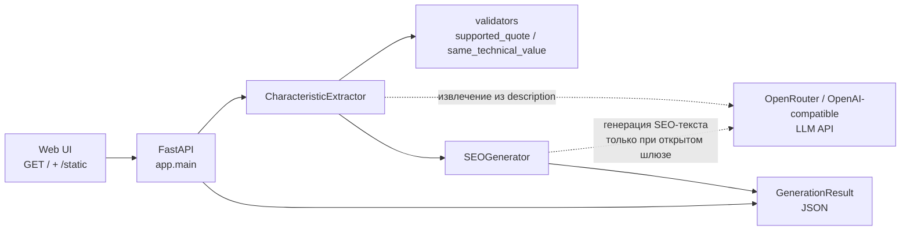
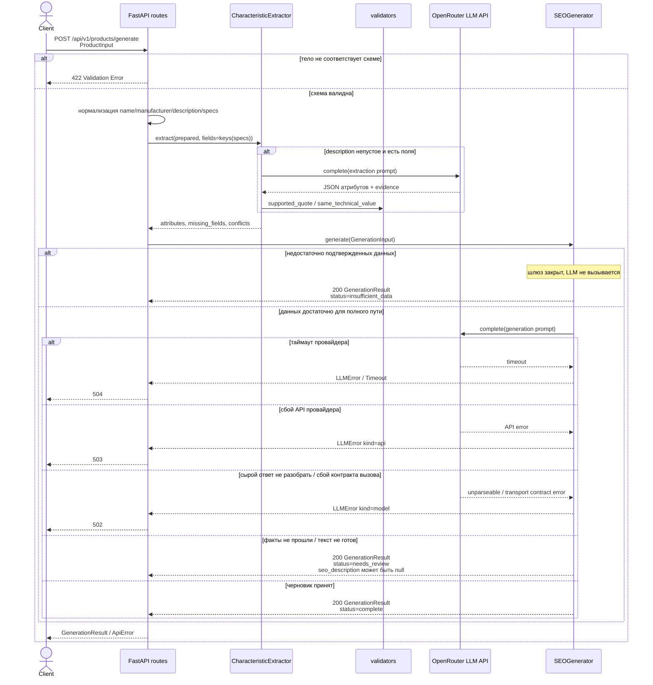

# Архитектура AI Product Card Generator

Документ описывает фактически реализованный конвейер сервиса.
Детали внутренней политики SEO Generator (обрезка, fail-soft, `needs_review`) могут дорабатываться отдельно — ниже зафиксирован стабильный внешний контракт HTTP API.

## Component Diagram

Слои приложения:

| Слой | Путь | Роль |
|------|------|------|
| HTTP | `app/api/` | маршруты, ошибки, OpenAPI-примеры |
| Config | `app/core/` | `pydantic-settings`, переменные окружения |
| Schemas | `app/schemas/` | контракты запроса/ответа |
| Services | `app/services/` | Extractor, Generator, validators |
| Clients | `app/clients/` | LLM-клиент (DI) |
| Prompts | `app/prompts/` | тексты промптов вне бизнес-логики |
| UI | `app/web/`, `app/static/` | страница контент-менеджера |

## Sequence Diagram

Обработка `POST /api/v1/products/generate`:

## Error Handling

| Ситуация | HTTP | Тело / статус | Источник в коде |
|----------|------|---------------|-----------------|
| Невалидное тело запроса | **422** | стандартный `ValidationError` FastAPI/Pydantic | схема `ProductInput` |
| Мало подтвержденных данных | **200** | `status: "insufficient_data"`, `warnings` | шлюз Generator; LLM не вызывается |
| Текст/поля не прошли проверку фактов | **200** | `status: "needs_review"`; `seo_description` / `commercial_block` могут быть `null` | политика Generator + grounding |
| Ответ LLM не принят на уровне вызова/разбора | **502** | `{"detail":"Модель вернула ответ, который не удалось принять."}` | `LLMErrorKind.MODEL` → `llm_http_exception` |
| Провайдер LLM недоступен / ключ пуст при реальном вызове | **503** | `{"detail":"Сервис языковой модели временно недоступен."}` | `LLMErrorKind.API` |
| Таймаут ответа провайдера | **504** | `{"detail":"Превышено время ожидания ответа языковой модели."}` | `TimeoutError` / `APITimeoutError` |
| Успешная полная карточка | **200** | `status: "complete"` | Generator |

Важно:

- `insufficient_data` и `needs_review` — **не** ошибки HTTP: это результаты с кодом 200.
- Не больше двух обращений к модели на одну карточку (основной ответ + опциональный rewrite описания).
- Служебные проверки: `GET /health` → `{"status":"ok"}`.
- Сообщения `ApiError.detail` не содержат стека, ключей и сырого текста провайдера.
